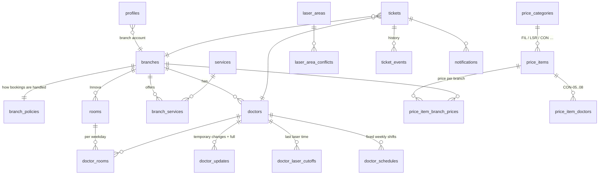

# Phase 1 — Database, Roles, RLS, SLA

Status: ✅ migrations + seed + tests pass on Postgres 16 (local harness).

> **Phase 1a update (migration 6, 2026-10-31).** Tickets are now **Innova-only**
> and **today/tomorrow-only**; the other 5 branches have no tickets and no branch
> accounts. The Innova branch reply set is **offered / full / confirmed**.
> "الحجز اكتمل" is a `full` doctor_update (per doctor/day or whole branch/day).
> **All editing is admin-only** — the one branch write left is: the Innova account
> may add/remove `full` for its own branch. Prices moved to a **per-branch model**
> (`price_categories` / `price_items` / `price_item_branch_prices`) mirroring
> `docs/data/price-list.xlsx` (Innova from the HTML). See §3c and §8.

## 1. The big picture



## 2. Tables in plain words

**Reference data (admin edits, everyone reads)**
| Table | What it holds | Example |
|---|---|---|
| `branches` | name, address, payment, managers, `has_tickets`, `logo_url` | Innova — has_tickets = true |
| `branch_policies` | how the branch handles bookings | Tanta 1: Saturdays auto-confirm · Tanta 2: same-day always needs the branch · Shebin: no overlap |
| `branch_laser_cutoffs` | branch-wide last laser time | Tanta 2: Mon/Tue/Thu morning shift, no laser after 2 PM |
| `doctors` | one doctor at one branch + her rules | Heba Ghonim: Open (`always_open`), no men, no small-only areas; `specialty` optional |
| `doctor_schedules` | weekly shifts, several per day allowed | Kholoud, Sat: 10–2 laser, 2–4 other services |
| `doctor_laser_cutoffs` | doctor's last laser time on a day | Mahitab, Sat: 6 PM |
| `rooms`, `doctor_rooms` | treatment rooms + per-weekday assignment (Innova) | Innova Room 1 / Room 2 |
| `services`, `branch_services` | 26 services and which branch offers them | HIFU → Tanta 2 only |
| `laser_areas` | 25 areas (women + men) with minutes | Full Arms 30 min · Bikini Line must not be alone |
| `laser_area_conflicts`, `laser_area_combos` | Half ↔ Full rules, combo durations | Half Arms + Half Leg = −30 min |
| `price_categories` | Excel sections, stable codes | `FIL`, `LSR`, `CON`, `DPN` (DPN `starts_from` = 750) |
| `price_items` | one row per Excel "كود البند" | `LSR-01`, `CON-03`, `INV-001`; `item_type` service/addon |
| `price_item_branch_prices` | price per item **per branch** | no row = unavailable · `0` = free |
| `price_item_doctors` | doctor-specific items | `CON-05..08` → Kholoud Fayrouz, Shimaa Hassan |
| `laser_area_price_map` | area/bundle → single + 3-session codes | Face & Neck → `LSR-03` / `LSR-04`. Pulse = `LSR-21`/`LSR-40` |
| `kb_articles` | 22 service guides, definitions, manual, **guide**, **chat** | `service:botox`, `guide:recommendations`, `chat:flow` |

**Written by branches (Innova only)**
| `doctor_updates` (type `full` only) | "الحجز اكتمل" for a doctor/day or the whole branch/day | admin also uses `off`·`stop`·`hours`·`open_slot`·`note`·`laser_stop`·`booking_cutoff` |

**Workflow**
| `tickets` | the coordination record (not the booking) |
| `ticket_events` | append-only history: created, responded, sla_breached, closed… |
| `notifications` | in-app alerts: new_ticket, ticket_answered, sla_breached |
| `profiles` | role + branch for each login |

## 3. Request, notice, or no ticket? (`resolve_ticket_kind`)

Client decision (2026-10-04, migration 5). First the **effective status** of the
doctor on that date (`effective_booking_status`):
1. Latest branch status override wins: `open_slot` → Confirmed, `force_open` → Open (branch may set these for today/tomorrow only).
2. Else Open doctor on an `auto_confirm_weekdays` day (Tanta 1: Saturday) → Confirmed.
3. Else the doctor's default status.

Then:

| # | Condition | Ticket | Dentolize status |
|---|---|---|---|
| 1 | Branch has `same_day_always_request` and date = today | REQUEST | Open |
| 2 | Effective status = Confirmed | NOTICE | Confirmed |
| 3 | Effective status = Open, date = today or tomorrow | REQUEST (5-min SLA) | Open |
| 4 | Effective status = Open, any later day | **no ticket** (`create_ticket` raises `no_ticket_needed`) | Open |

## 3b. Branch self-service (migration 5)
- `doctor_updates` with `doctor_id = null` = **branch-wide** for a date range: `off` (closed / event), `stop` (fully booked), `note`.
- Branch edits its own doctors' **weekly schedules** (`doctor_schedules`). Doctor rules and prices stay admin-only.
- Every update / schedule change notifies all agents + supervisors (`branch_update`, `schedule_changed`), de-duplicated per 2 minutes.
- `create_ticket` refuses bookings on blocked days: `doctor_unavailable_on_date` / `branch_unavailable_on_date`.

## 3c. Phase 1a — Innova-only tickets + price model (migration 6)

Client decisions (2026-10-31):
- **Tickets exist only for Innova** (`branches.has_tickets`). `create_ticket` raises
  `tickets_not_enabled_for_branch` for any other branch. The other 5 branches: the agent books
  in Dentolize, follows the steps, presses "تم الحجز" — no ticket, no branch account.
- **Today/tomorrow only**: `create_ticket` raises `ticket_only_today_tomorrow` past tomorrow.
- **`full` block**: a `full` doctor_update (per doctor/day or branch-wide/day) makes
  `create_ticket` raise `fully_booked` (`full_update()` checks both). Admin and the Innova
  branch account can add/remove it.
- **Branch reply set** (`branch_respond`, Innova): `offered` (needs `offered_time`), `full`
  (no slots → postpone), `confirmed`. Old values (`agent_confirm`…) are kept on the enum so
  historical rows stay valid, but the RPC rejects them (`invalid_response`). All three move the
  ticket to `answered`; the agent calls the customer and closes it. 5-min SLA + supervisor
  escalation kept.
- **Admin-only editing**: branch write policies on `doctor_schedules` and the broad
  `doctor_updates` write were dropped. The only branch write left: the Innova account may
  `insert`/`delete` `doctor_updates` with `type = 'full'` for its own branch.
- **Prices** are a per-branch model (`price_item_branch_prices`). `price_text` carries textual
  prices (Innova Re Cons = "مجاني خلال شهر"). Pulse = `LSR-21` (women) / `LSR-40` (men);
  the consultation card reads `CON-01..08`.

## 4. Ticket lifecycle (Innova)

```
REQUEST:  pending ──branch_respond (offered|full|confirmed)──▶ answered ──close_ticket──▶ closed
             │  (5 min) mark_sla_breaches → stays pending, flagged red,
             │                              supervisor notified (branch can still answer)
Any open ticket ──cancel_ticket──▶ cancelled
```

## 5. Who can do what (RLS)

| | admin | supervisor | agent | branch |
|---|---|---|---|---|
| Read reference data | ✅ | ✅ | ✅ | ✅ |
| Edit reference data (doctors, schedules, prices, rules) | ✅ | — | — | — |
| Write doctor updates | ✅ (all types) | — | — | **`full` only, own branch** |
| See tickets | all | all | all | own branch only (Innova) |
| Create / close ticket | ✅ | ✅ | ✅ | — |
| Answer (`branch_respond`) | ✅ | — | — | own branch only (Innova) |
| Cancel ticket | ✅ | ✅ | own tickets | — |
| SLA alerts | — | ✅ | — | — |

Tested in `supabase/tests/10_workflow_and_rls_test.sql`: non-Innova tickets rejected; Innova
today/tomorrow only; `full` blocks per doctor and per branch; the branch may add/remove only its
own `full`; the branch cannot edit schedules or prices; admin can edit prices.

## 6. Deploying to Supabase

1. `supabase init` (keep the existing `supabase/migrations` and `seed.sql`).
2. `supabase link --project-ref <ref>` then `supabase db push`.
3. Load data once: run `supabase/seed.sql` in the SQL editor (or `supabase db reset` locally).
4. Enable **pg_cron** in Dashboard → Database → Extensions if the migration reports it is missing, then re-run the `cron.schedule` line from migration 4.
5. Create the first admin: add a user in Auth, then insert their `profiles` row with role `admin`.

## 7. Open questions (defaults in place, easy to change)

1. ~~Open doctor after tomorrow~~ → decided: no ticket.
2. **Notice acknowledgement**: built as an optional "تم الاطلاع" button, no SLA. Not confirmed yet.
3. **SLA alerts** go to every `supervisor`. Ahmed Taher's account gets that role. Should admins get them too?
4. **Shimaa Hassan's temp note (23/9)** was expired and skipped. The branch can re-add notes as `note` updates.
5. **New Cairo "Lara" Saturday shift** is "other services only" — parsed as `other`. Please verify a few schedules in the admin screen after go-live.
6. **Dr Nourhan El Abd (Kafr El-Sheikh)** has a `tempNote` ("stopped new bookings from 9 Oct") not imported — applied as a `stop` update (2026-10-09 → 2027-10-09) via `supabase/post-sync.sql`; admin can remove it.
7. **Laser areas with no standalone price** (`w_underarm`, `w_bikini`, `w_neck`, `w_bikiniline`, `w_mustache`): kept **unpriced alone** (client decision, 2026-10-31). When one is chosen without its bundle partner, the pricing engine (phase 3) must return **"no standalone price"**, show the bundle that contains it (Bikini & Underarms → `LSR-05/06`, Face & Neck → `LSR-03/04`), and the **per-pulse** price (`LSR-21` women / `LSR-40` men). Never invent a price. **Open question for the client:** should these areas get their own single-area prices, or stay bundle-only?

## 8. Price model & data sync

Two sources of truth, two generators:

| Source | Generator | Owns |
|---|---|---|
| `docs/mvp/agent-hub-2026-10.html` | `scripts/extract-mvp.mjs` | branches, doctors, schedules, rooms, services, laser areas, kb (incl. guide/chat) |
| `docs/data/price-list.xlsx` (+ Innova from the HTML) | `scripts/import-prices.mjs` | `price_categories`, `price_items`, `price_item_branch_prices`, `price_item_doctors`, `laser_area_price_map` |

```bash
node scripts/extract-mvp.mjs > supabase/seed.sql   # full seed (extractor calls the price importer)
node scripts/import-prices.mjs                      # prices only, idempotent upsert SQL (admin "upload price list")
node scripts/import-prices.mjs --json               # normalised price model (used by the dry-run report)
node scripts/gen-sync-report.mjs /tmp/seed-old.sql  # docs/sync-report.md — diff vs the current DB (dry run)
```

Both generators are **idempotent**: entities upsert by code and set `is_active = false` for codes
that have left the source (never deleted — keeps ticket history); child/link tables and prices are
refreshed. Item codes (Excel "كود البند") are stable: change a price, keep the code.

The per-branch price rules: **no row in `price_item_branch_prices` = not available in that branch**
(e.g. HIFU/Dental → Tanta Saeed only, VIVACE → New Cairo only); **`0` = free** (e.g. Hyalase when the
filler was injected at Allure). Offers are not in the file. See `docs/sync-report.md` for the full diff.

## TODO — move branch guidance copy to the DB (admin-panel phase)

The per-branch booking guidance (`steps` / `info` / `warns`) rendered by the
booking wizard is currently **hardcoded** in `lib/engine/decision.ts` (a
faithful port of `decide()` in `docs/mvp/agent-hub-2026-10.html`). In the
admin-panel phase, move this copy into the database (e.g. a
`branch_guidance` table keyed by branch + condition) so an admin can edit the
steps/info/warns text without a code change. Until then, any wording change
must be made in `decision.ts` and covered by the Vitest suite.

## TODO — recreate the ticket_board view (admin-panel phase)

`ticket_board` predates migration 6: it lacks `offered_time` and still carries
the dead `counter_date` / `counter_start_time` / `counter_doctor_id` columns.
The agent tickets UI currently works around this by merging `offered_time` from
the `tickets` table. In the admin-panel phase, `create or replace view
public.ticket_board` to add `offered_time` and drop the `counter_*` columns,
regenerate `lib/types/database.types.ts`, then remove the merge in
`components/tickets/tickets-list.tsx` + `app/(agent)/dashboard/tickets/page.tsx`.
